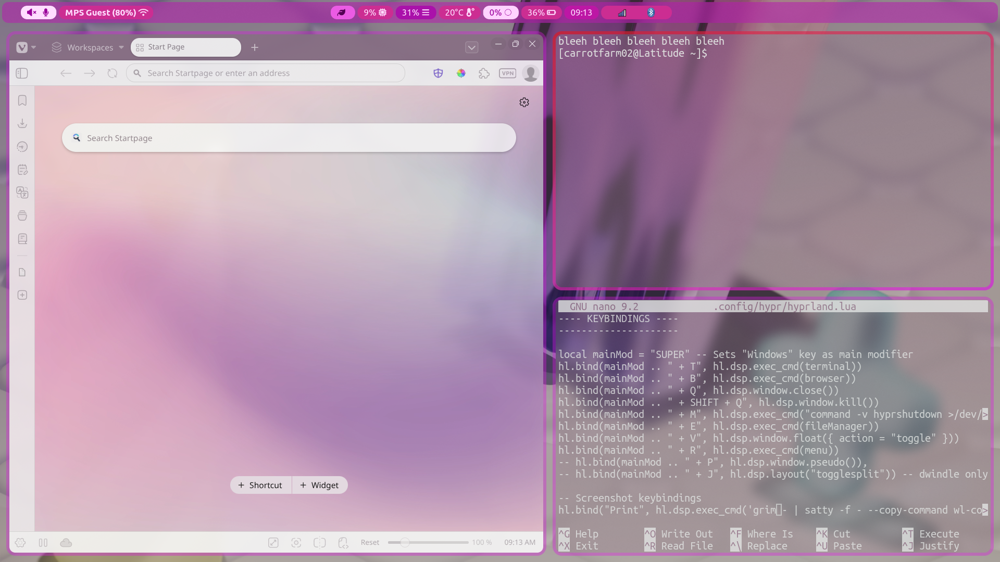
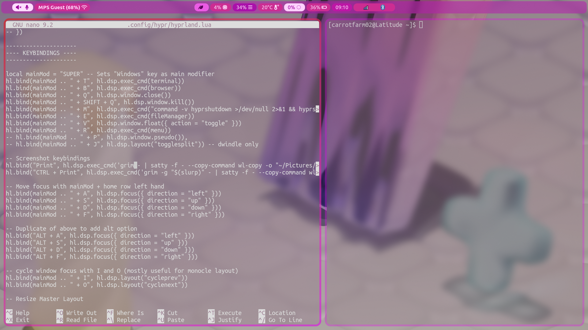
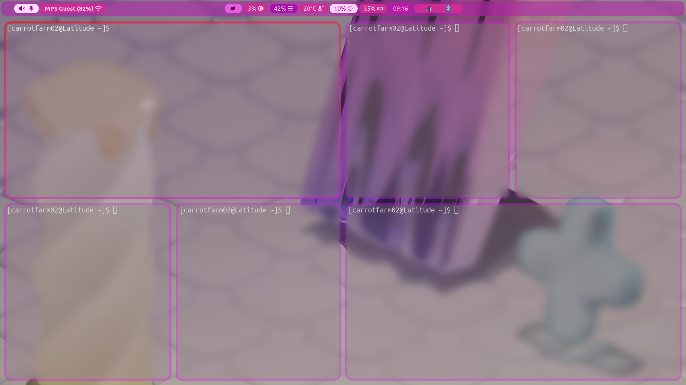
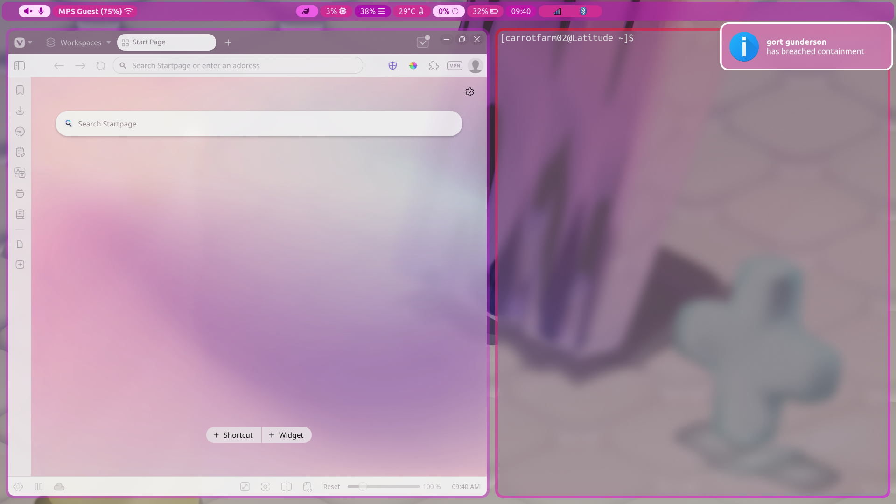

# My-Hypr-Dotfiles
This is mostly for me, but feel free to steal if you want though.

## DEPENDENCIES 
Requires the following packages: 

Hyprland (and all of its dependencies)

Grim, Slurp, and Satty (for screenshots)

Waybar (for the top bar)

Kitty (main terminal emulator)

Hyprpaper (for the wallpaper)

Dolphin (as the file manager)

Rofi (aplication launcher)

Dunst (notification dispatcher)

Nerd Fonts (the font library that contains the terminal font used for this config)

Optional: plugin "Gloview", by fedsfarm on GitHub.

## INSTALLATION INSTRUCTIONS
step one:

run `git clone https://github.com/carrotfarm02/My-Hypr-Dotfiles` to clone the repository

step two:

make the customizations you want (browser, or whatever)

step three:

move all of the files except for the README inside the 'My-Hypr-Dotfiles' folder, and the 'Previews' folder into ~/.config (these files are deletable without repercussion)

aaaaand you're done! :)
